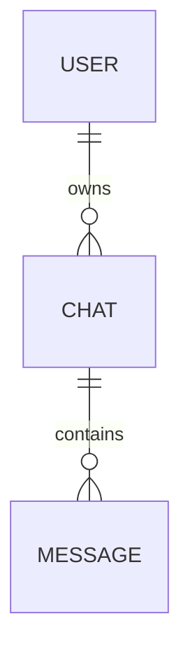

# Data Modeling

## Purpose
Design data that stays correct, private and fast as the app grows. We start from how the data is read
and written (access patterns), not from a list of tables, and we plan the first migration before the
first row exists. Storage comparison, Blobs limits and SQL patterns are in [reference.md](reference.md).

## Procedure
1. **List access patterns first.** For every screen, API route and background job, write one row:
   who reads/writes, what data, filter and sort, how often, expected size, and whether a reader must see
   a write immediately (consistency). Mark the 3–5 hottest patterns.
2. **Name entities and relationships.** Entities, attributes, 1:1 / 1:N / N:M links, and the owner of
   each record (user, team, tenant). Draw it as a Mermaid `erDiagram`.
3. **Classify every field** as public, internal, personal, or sensitive (health, finance, children,
   precise location, credentials). Drop any field no access pattern needs (data minimisation). Hand
   personal/sensitive fields to the privacy-compliance agent.
4. **Choose storage** with the decision table in reference.md:
   - Browser only (localStorage / IndexedDB): private, per-device data with no sharing or sync.
   - Netlify Blobs: key-value documents, few writes, lookups by key or key prefix, no joins.
   - Postgres (including Supabase): relations, filters, sorting, aggregates, transactions, many writers.
   Record the choice and the rejected options in one paragraph (or an ADR via the software-architect).
5. **Define the schema (SQL).** For each table: primary key, columns with types, `NOT NULL` by default,
   defaults, `CHECK` constraints, foreign keys with an explicit `ON DELETE`, and unique constraints that
   encode business rules. Conventions:
   - IDs: UUID (v7 when available, for time order); never expose sequential integers in URLs.
   - Time: `timestamptz` in UTC, `created_at` and `updated_at` on every table.
   - Money: integer minor units (cents) plus a currency code; never floats.
   - Enums: `CHECK (status IN (...))` or a lookup table; avoid free text for states.
   - Soft delete (`deleted_at`) only when undo or audit is a requirement; otherwise delete for real.
6. **Or define the key layout (Blobs).** One store per entity type. Keys built server-side from
   trusted values, e.g. `users/{userId}/chats/{chatId}`, so `list({ prefix })` answers the hot query.
   Store JSON with a `schemaVersion` field. Use `onlyIfNew` for creates and `onlyIfMatch` (ETag) for
   updates where two writers can collide (Blobs is last-write-wins). Choose `consistency: "strong"` only
   where a reader must see a write at once. Never use raw user input as a key.
7. **Add indexes from access patterns only.** One index per hot filter/sort; composite index column
   order = equality columns first, then range/sort column. Verify with `EXPLAIN ANALYZE` on realistic
   volumes. Use keyset pagination (`WHERE created_at < $cursor ORDER BY created_at DESC LIMIT 50`) for
   large lists, not `OFFSET`.
8. **Lock down access.** Supabase: enable Row Level Security on every table reachable from the client and
   write a policy per operation; keep the service-role key server-side only. Postgres via functions:
   least-privilege database role. Blobs: only reachable through your own functions; check ownership on
   every read.
9. **Validate at the boundary.** One zod schema per entity, shared by API handlers and data access;
   reject unknown fields; cap string lengths to match the column limits.
10. **Plan migrations.** Versioned, forward-only files `db/migrations/NNNN_<what>.sql`; never edit an
    applied file. For breaking changes use **expand → backfill → switch reads → contract** across separate
    deploys. Take a backup or export before running in production. For Blobs, migrate lazily on read
    using `schemaVersion`, then run a one-off backfill.
11. **Plan retention and deletion.** For each entity: how long it is kept, how a user's data is exported
    and deleted, and what happens to backups. Add expiry metadata where data should age out.
12. **Project one year ahead.** Estimate rows/objects, total size, hottest key or table and the slowest
    query at that size. Note what changes at 10× (partitioning, archiving, caching).
13. **Seed and test.** Deterministic seed data with no real personal data; tests for constraints
    (duplicate rejected, cascade works, RLS denies another user's row).

## Checklist
- [ ] Access-pattern table written before the schema; hot patterns marked
- [ ] ERD drawn; every record has a clear owner
- [ ] Every field classified; unneeded personal fields removed
- [ ] Storage choice recorded with rejected options
- [ ] Primary keys, NOT NULL, defaults, CHECKs, FKs with ON DELETE, unique rules defined
- [ ] UTC timestamps, UUIDs, integer money, constrained enums
- [ ] Blobs: trusted keys, prefix layout, schemaVersion, ETag writes where needed, consistency chosen
- [ ] Indexes match hot patterns; EXPLAIN checked; keyset pagination for long lists
- [ ] RLS / least privilege / ownership checks in place; no service keys in the browser
- [ ] zod validation at every write path
- [ ] Migration files versioned; expand-contract plan for breaking changes; backup step
- [ ] Retention, export and deletion path per entity
- [ ] One-year size estimate and 10× note
- [ ] Seed data contains no real personal data; constraint and access tests listed

## Output template
````markdown
# Data model: <feature or app>
Date: YYYY-MM-DD · Owner: data-engineer · Storage: <Blobs | Postgres | Supabase | browser>

## Access patterns
| # | Actor | Operation | Data | Filter / sort | Freq | Consistency | Hot? |
|---|---|---|---|---|---|---|---|

## Entities (ERD)


## Storage decision
<choice, why, options rejected>

## Schema / key layout
<SQL DDL or Blobs store + key patterns + JSON shape with schemaVersion>

## Indexes
| Index | Serves pattern # | Verified with EXPLAIN |
|---|---|---|

## Field classification
| Entity.field | Class | Why needed | Retention |
|---|---|---|---|

## Access control
<RLS policies / roles / ownership checks>

## Migration plan
<files, expand-contract steps, backup, rollback>

## One-year projection
<rows, size, hotspot, what changes at 10×>

## Open questions
- ...
````
