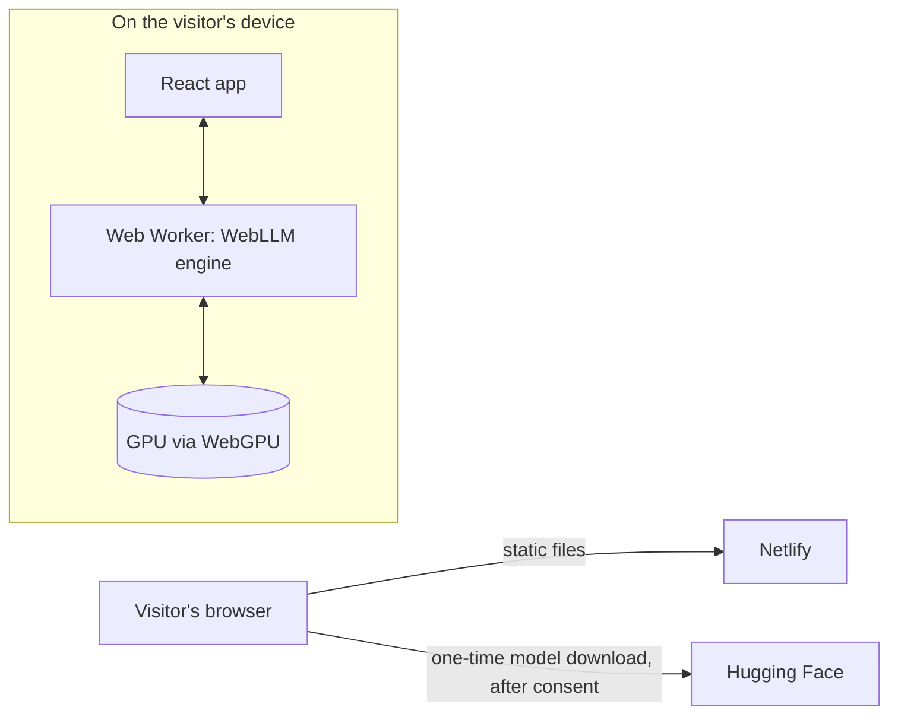

# BrainyApp2

**A free AI product studio that runs in your browser.** Chat with 31 AI experts in strategy, UX/UI design, engineering, QA and launch, ask the whole team for one combined answer, or turn a description into a complete, accessible web page.

Live site: https://brainyapp2.netlify.app

- **Free and private.** The AI runs on your own device with [WebLLM](https://webllm.mlc.ai) and WebGPU. What you type never leaves your browser. There are no accounts, no API keys and no cost per answer.
- **Choose a model once.** The first time, you pick a model and your browser downloads it from Hugging Face (about 0.85 GB for Balanced, measured; Quality is larger). It's saved for next time and works offline.
- **Same team in Claude Code.** The 31 agents in `.claude/agents` work in Claude Code for real, multi-file builds.



## Models

| Tier | Model | Graphics memory needed | Licence |
|---|---|---|---|
| Lite | Llama-3.2-1B-Instruct | ≈0.9 GB | Llama 3.2 Community Licence (Built with Llama) |
| Balanced (default) | Qwen2.5-1.5B-Instruct | ≈1.6 GB | Apache-2.0 |
| Quality | Phi-4-mini-instruct | ≈3.4 GB | MIT |

The IDs are pinned in `web/src/ai/models.ts` and tested against the installed `@mlc-ai/web-llm` version. See `docs/models.md`.

## Browser support
You need a browser with WebGPU and enough graphics memory, for example a recent Chrome or Edge on a laptop or desktop. Support is detected on the device, not guessed from the browser name. Without WebGPU, the site explains what is needed and offers to copy the expert's prompt, and the team, library and guides still work.

## Honest limits
- Small models give short, simpler answers. They are good for advice, outlines and copy, and weak at complex reasoning and long code.
- The Studio builds pages (landing pages, portfolios, shop fronts) from tested blocks. For apps, dashboards and games it writes a Claude Code prompt instead.
- Team mode runs experts one after another on your device, so it takes longer than a single answer.

## Local development
```bash
npm install
npm run dev                          # http://localhost:5173 (real WebGPU engine)
VITE_MOCK_ENGINE=1 npm run dev       # mock engine: no GPU or download needed
npm test                             # unit tests
npx playwright test                  # end-to-end + accessibility (mock engine)
./scripts/gates.sh                   # every gate, evidence in reports/gates.md
```

## Deploy
Import the repository into Netlify. The build settings come from `netlify.toml`, and no environment variables are needed. New Netlify projects start private, so click **Make public**.

## Troubleshooting
- **"This device can't run the free AI"**: update the browser and graphics drivers, and turn on hardware acceleration.
- **Out of memory**: choose Lite and close other tabs.
- **"Running in another tab"**: only one tab can use the AI at a time.

## Licence
The code is MIT-licensed (see `LICENSE`). WebLLM and MLC are Apache-2.0; each model keeps its own licence (table above).
