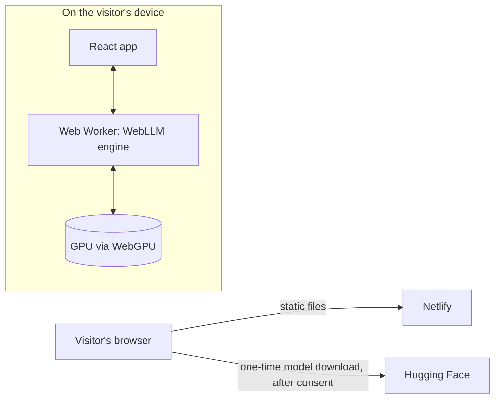

# NLPFinalJM: BrainyApp2 + NLTK and spaCy

**A free AI product studio that runs in your browser.** Chat with 36 AI experts in strategy, UX/UI design, engineering, QA and launch, ask the whole team for one combined answer, or turn a description into a complete, accessible web page.

Live site: https://nlpfinaljm.netlify.app (NLP Lab: https://nlpfinaljm.netlify.app/nlp)
Repository: https://github.com/jonathanwmartineza-collab/NLPFinalJM
Final project guide: https://claude.ai/artifact/K55JqCeSxXULMmzki6yv73

## NLP final project

This repository is the NLP final project. It adds Python NLP to BrainyApp2 with **both NLTK and spaCy**, each on a clearly labelled part of the site, and keeps the site fully static on Netlify.

| Part | Library | Where it runs | What it does |
|---|---|---|---|
| Prompt coach (NLP Lab and under every chat box) | NLTK + spaCy topic index | Live in the browser (Pyodide) | Flags vague words and hedges, scores the question on 5 checks, finds key topics and the best experts, writes a sharper question |
| Chat insights | NLTK | Live in the browser | Tokens, stopwords, FreqDist top words, collocations, VADER tone per sentence |
| Team agreement map (NLP Lab and under every whole-team answer) | NLTK + spaCy | Live in the browser | Main ideas per expert, tone per expert, shared ideas, agree or disagree per pair |
| What each expert knows | spaCy | Deploy time (Python on Netlify) | Named entities with an EntityRuler (TECH, STANDARD, METHOD) before the statistical NER, noun-chunk topics |
| Dependency parse | spaCy | Deploy time | Parse of each library prompt's goal, drawn as arcs, with a token table |
| Words and tone across the studio | NLTK | Deploy time | FreqDist, collocations and VADER over all 36 expert profiles |

How it is built:

- `nlp/build_nlp.py` runs during the Netlify build. It reads the team (`web/public/team.json`, `.claude/agents/*.md`, `knowledge/`) and the prompt library, runs NLTK and spaCy (`en_core_web_sm` + `nlp/patterns.jsonl`), and writes static JSON to `web/public/nlp/`. It fails the build if any result is empty.
- The live box loads Pyodide 314.0.8 from jsDelivr (it ships NLTK 3.9.4, the same version the build uses) in a module Web Worker (`web/src/nlp/nltk.worker.ts`), plus `nltk_core.py` and a 188 KB NLTK data zip (about 15 MB in all the first time, then cached). Nothing downloads until you press a button that uses NLTK (**Load NLTK**, **Coach my question**, **Analyse with NLTK** or **Map agreement**). Your text stays on your device.
- `requirements.txt` pins NLTK 3.9.4, spaCy 3.8.18 and the `en_core_web_sm` 3.8.0 wheel; `netlify.toml` sets `PYTHON_VERSION = "3.13"`, the build command and `publish = "web/dist"`.

The agent team (`.claude/agents`, `.claude/skills`, `knowledge/`, `CLAUDE.md`) gained an NLP department: Nora Lindahl (NLTK expert), Santiago Reyes (spaCy expert), Petra Novak (Pyodide engineer), Bruno Adeyemi (Python build engineer) and Esther Kwon (NLP evaluator). See `docs/expert-roster.md`, `docs/agent-brains.md` and the research in `docs/research/`.

### Deploy the NLP final on Netlify
1. In Netlify, choose **Add new project → Import an existing project → GitHub** and pick `NLPFinalJM`.
2. Keep the settings Netlify reads from `netlify.toml` (build command `node scripts/build-team.mjs && python3 nlp/build_nlp.py && npm run build`, publish directory `web/dist`, Python 3.13, Node 22). No environment variables are needed.
3. Deploy. Netlify installs Python 3.13 and `requirements.txt`, then runs the build. The build log shows `build_nlp: OK ...` when NLTK and spaCy finished; if any NLP result is empty the build fails and nothing is deployed.
4. New Netlify projects start private: click **Make public**, then open https://nlpfinaljm.netlify.app/nlp.
5. Check `/nlp`: every panel shows an NLTK or spaCy label; press **Try an example** in the Prompt coach to see the live NLTK result.

Later pushes deploy automatically. `netlify.toml` has an `ignore` command (`scripts/should-build.sh`) that skips the build when a push changes none of the paths in `scripts/build-paths.txt` (for example a README-only push).

### Run the NLP part locally
```bash
python3 -m venv .venv && . .venv/bin/activate
pip install -r requirements.txt pytest
npm install
npm run build:all                 # team.json, then NLTK + spaCy JSON, then the site
npm run dev                       # open http://localhost:5173/nlp
```

### Run the tests
```bash
npm run test:py                   # pytest: NLTK core (tokens, stopwords, FreqDist, collocations, VADER, coach,
                                  # agreement) and the build output (spaCy entities, EntityRuler, topics, parses)
npm test                          # Vitest unit tests (team build, router, safety, Studio, models)
PYODIDE_INDEX=/path/to/pyodide/ node tests/node/pyodide-nltk.mjs
                                  # runs the browser's NLTK code (web/src/nlp/boot.ts) in Node with Pyodide and
                                  # checks it matches the CPython build output in web/public/nlp/nltk.json
```
Run `npm run build:nlp` (or `build:all`) before `test:py` and the Pyodide test, because both read `web/public/nlp/`. The Pyodide test needs Node 22.18 or later (it imports a `.ts` file). `PYODIDE_INDEX` must point to a full local Pyodide 314.0.8 distribution (the folder with `pyodide.mjs` and `nltk-3.9.4-py3-none-any.whl`); the `pyodide` npm package alone does not include the NLTK wheel. Without `PYODIDE_INDEX` the test downloads Pyodide from jsDelivr.

### Where each exam requirement lives
| Requirement | Files | Where to see it |
|---|---|---|
| README with deploy steps | `README.md` | this file |
| Resources page (docs, repo, guide) | `web/src/pages/ContentPages.tsx` (`ResourcesPage`) | `/resources`, linked from the header (`web/src/App.tsx`), the sidebar and the chat footer |
| Every panel labelled NLTK or spaCy | `Lib` and `Panel` in `web/src/nlp/ui.tsx`, used in `web/src/pages/NlpPage.tsx` | the label at the top of each `/nlp` panel |
| NLTK: tokenize and stopwords | `tokenize`, `content_words` in `nlp/nltk_core.py` | `/nlp` Chat insights (live) |
| NLTK: VADER | `sentiment`, `analyze` in `nlp/nltk_core.py` | Chat insights (tone per sentence), Prompt coach, Team agreement map, Words and tone across the studio |
| NLTK: FreqDist and collocations | `top_words`, `collocations` in `nlp/nltk_core.py` | Chat insights (live); Words and tone across the studio (build) |
| spaCy: named entities and EntityRuler | `load`, `entities` in `nlp/spacy_core.py`; 107 patterns in `nlp/patterns.jsonl` (TECH, STANDARD, METHOD) | What each expert knows |
| spaCy: noun chunks | `topics` in `nlp/spacy_core.py` | What each expert knows (Topics); also the topic index the Prompt coach uses |
| spaCy: dependency parse | `parse` in `nlp/spacy_core.py` | Dependency parse (arcs and token table) |
| Build-time pipeline to static JSON | `nlp/build_nlp.py`, `netlify.toml`, `requirements.txt` → `web/public/nlp/` (`spacy.json`, `nltk.json`, `topic-index.json`, `corpus-stats.json`) | corpus line at the top of `/nlp` (versions and build time) |
| Live NLTK in Pyodide | `web/src/nlp/nltk.worker.ts`, `boot.ts`, `client.ts`; runs the same `nlp/nltk_core.py` | Prompt coach, Chat insights, Team agreement map (**Load NLTK**) |
| Agent team | `.claude/agents/` (36 agents), `.claude/skills/` (49 skills), `knowledge/`, `CLAUDE.md`, `docs/expert-roster.md`, `docs/agent-brains.md` | Resources page, Team line |
| Research | `docs/research/` (`README.md` and `01` to `07`) | Resources page, Research line |
| Tests | `tests/python/`, `tests/node/pyodide-nltk.mjs`, `tests/unit/` | see Run the tests |

## BrainyApp2 (the app the NLP Lab is built on)


- **Free and private.** The AI runs on your own device with [WebLLM](https://webllm.mlc.ai) and WebGPU. What you type never leaves your browser. There are no accounts, no API keys and no cost per answer.
- **Choose a model once.** The first time, you pick a model and your browser downloads it from Hugging Face (about 2.2 GB for Quality, the recommended model; Lite is about 0.7 GB). It's saved for next time and works offline.
- **Same team in Claude Code.** The 36 agents in `.claude/agents` work in Claude Code for real, multi-file builds.



## Models

| Tier | Model | Graphics memory needed | Licence |
|---|---|---|---|
| Lite | Llama-3.2-1B-Instruct | ≈0.9 GB | Llama 3.2 Community Licence (Built with Llama) |
| Quality (default) | Qwen3-4B | ≈3.4 GB | Apache-2.0 |

The IDs are pinned in `web/src/ai/models.ts` and tested against the installed `@mlc-ai/web-llm` version. See `docs/models.md`.

## Browser support
You need a browser with WebGPU and enough graphics memory, for example a recent Chrome or Edge on a laptop or desktop. Support is detected on the device, not guessed from the browser name. Without WebGPU, the site explains what is needed and offers to copy the expert's prompt, and the team, library and guides still work.

## Honest limits
- Small models give short, simpler answers. They are good for advice, outlines and copy, and weak at complex reasoning and long code.
- The Studio builds pages (landing pages, portfolios, shop fronts) from tested blocks. For apps, dashboards and games it writes a Claude Code prompt instead.
- Team mode runs experts one after another on your device, so it takes longer than a single answer.

## Local development
```bash
npm install
npm run dev                          # http://localhost:5173 (real WebGPU engine)
VITE_MOCK_ENGINE=1 npm run dev       # mock engine: no GPU or download needed
npm test                             # unit tests
npx playwright test                  # end-to-end + accessibility (mock engine)
./scripts/gates.sh                   # every gate, evidence in reports/gates.md
```

## Deploy
Import the repository into Netlify (see the NLP final steps above). The build settings come from `netlify.toml`, and no environment variables are needed. New Netlify projects start private, so click **Make public**.

## Troubleshooting
- **"This device can't run the free AI"**: update the browser and graphics drivers, and turn on hardware acceleration.
- **Out of memory**: choose Lite and close other tabs.
- **"Running in another tab"**: only one tab can use the AI at a time.

## Licence
The code is MIT-licensed (see `LICENSE`). WebLLM and MLC are Apache-2.0; each model keeps its own licence (table above).
