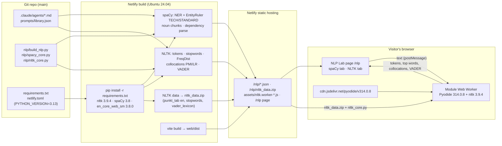

# 07 — Recommended architecture

**One sentence:** spaCy and NLTK run in Python **during the Netlify build** to precompute corpus results as
static JSON; NLTK **also** runs **live in the visitor's browser** (Pyodide in a module Web Worker) to analyse
the user's own chat. No server, no Functions, no keys — the app stays fully static.

## Diagram

## Data flow
1. **Push to `main`** → `scripts/should-build.sh` decides to build (needs `nlp/` and `requirements.txt` in
   `scripts/build-paths.txt`).
2. **Install:** Netlify sets Python 3.13 and runs `pip install -r requirements.txt`.
3. **Precompute:** `python nlp/build_nlp.py` reads the corpus, runs `spacy_core` and `nltk_core`, downloads
   the three NLTK data packages, and writes `web/public/nlp/`.
4. **Bundle:** `npm run build` (Vite) copies `web/public/` into `web/dist/` and builds the `/nlp` route.
5. **Serve:** Netlify CDN serves everything as static files.
6. **spaCy tab:** the page fetches `/nlp/experts.json` (and friends) and renders entities, topics, parse.
7. **NLTK tab:** on first open, the page starts the worker; the worker loads Pyodide + nltk from jsDelivr,
   fetches and unpacks `nltk_data.zip`, loads `nltk_core.py`, then answers `analyse(text)` messages.

## File map

| Path | Role | Library |
|---|---|---|
| `requirements.txt` | pins `nltk==3.9.4`, `spacy>=3.8,<3.9`, `en_core_web_sm` 3.8.0 wheel URL | both |
| `netlify.toml` | `PYTHON_VERSION=3.13`; build command runs the Python step first; `/nlp` redirect | — |
| `nlp/spacy_core.py` | `load_nlp()` adds `entity_ruler` **before `ner`** with TECH/STANDARD patterns; `analyse_doc()` → entities, noun-chunk topics, dep parse | **spaCy** |
| `nlp/nltk_core.py` | `analyse(text)` → tokens, stopword-filtered `FreqDist`, bigram PMI + likelihood ratio, VADER (compound + label at ±0.05). Same file used at build time **and** in the browser. | **NLTK** |
| `nlp/build_nlp.py` | loads corpus, runs both cores, writes JSON + `nltk_data.zip`, copies `nltk_core.py` to `web/public/nlp/` | both |
| `web/public/nlp/experts.json` | per expert: spaCy entities, TECH/STANDARD, topics, sample parse; NLTK top words, collocations, VADER | both |
| `web/public/nlp/corpus-stats.json` | document and word counts, versions, build time | — |
| `web/public/nlp/nltk_data.zip` | English `punkt_tab`, `stopwords`, `vader_lexicon` in NLTK's folder layout | NLTK |
| `web/src/nlp/nltk.worker.ts` + `boot.ts` | module worker (bundled by Vite): `loadPyodide`, `loadPackage("nltk")`, `unpackArchive`, run `nltk_core.analyze`, `coach`, `agreement` | NLTK |
| `web/src/pages/NlpLab.tsx` (route `/nlp`) | two clearly labelled sections: "spaCy — what each expert knows" and "NLTK — analyse your chat (live)" | — |
| `tests/` | pytest for `nlp/*_core.py`; vitest/Playwright for the page | — |

Generated files in `web/public/nlp/` can be git-ignored (they are rebuilt on every deploy) or committed
for local dev; decide once and document it.

## Alternatives rejected

| Alternative | Why rejected |
|---|---|
| **spaCy in a Netlify Function** (server API) | Netlify Functions support JavaScript/TypeScript and Go, **not Python**. Would also break the app's "fully static, no server" rule and add per-request cost. |
| **spaCy in Pyodide** (browser) | spaCy, thinc and blis are **not** in the Pyodide 314 distribution; community wheels exist only for spaCy 3.7.5 / Python 3.12 / Pyodide 2024 ABI. Even if built, the browser would download Pyodide + the compiled stack + a 12 MB model. The corpus is fixed, so build-time results are identical and free. |
| **JS-only NLP libraries** (e.g. compromise, wink-nlp, natural) | The exam requires NLTK **and** spaCy specifically; JS ports would not satisfy it and would duplicate logic in another language. |
| **External NLP API** | Needs keys and a server; sends user text off-device (privacy); against the app's design. |
| **NLTK only at build time** | Would satisfy the letter of the exam but give no live interaction; running NLTK live shows it working on the user's own text. |
| **`nltk.download()` inside the browser** | Fetches from GitHub at run time, needs extra CSP/CORS and network; a single prebuilt zip is faster and deterministic. |

## Risks and checks
- [ ] Module worker (`type: "module"`) — classic `importScripts` is not supported by Pyodide 314.
- [ ] Same NLTK version in both places (3.9.4) — assert `nltk.__version__` in the worker and the build.
- [ ] Build fails loudly if spaCy or a data package is missing (no silent empty JSON).
- [ ] `/nlp` page contains no `github.com` links (the existing e2e privacy test forbids repo links on the site).
- [ ] Accessibility: labelled inputs, live region for results, progress text while Pyodide loads.

## Sources
- See [05-netlify](05-netlify.md), [06-pyodide](06-pyodide.md), [03-spacy](03-spacy.md) and
  [02-nltk](02-nltk.md) for the primary sources behind each decision (all accessed 2026-11-26).
- Netlify functions languages — https://docs.netlify.com/build/functions/get-started/ (accessed 2026-11-26)
- Pyodide packages list — https://pyodide.org/en/stable/usage/packages-in-pyodide.html (accessed 2026-11-26)
- Pyodide web worker — https://pyodide.org/en/stable/usage/webworker.html (accessed 2026-11-26)
- Repository files `netlify.toml`, `scripts/build-paths.txt`, `tests/e2e/site.spec.ts`, read 2026-11-26.
